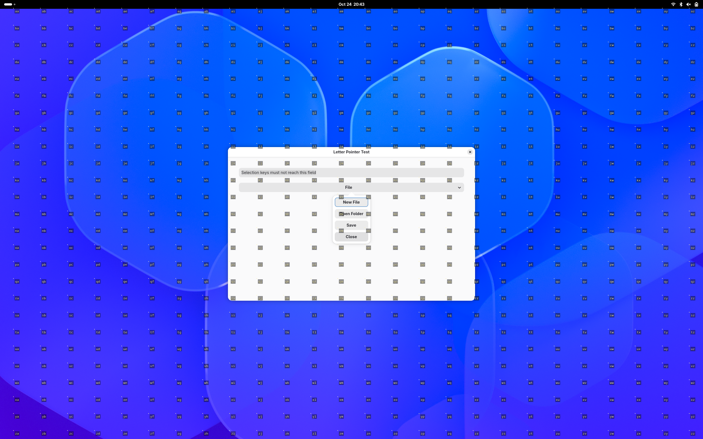

# Letter Pointer

GNOME Wayland 下的双字母鼠标选点扩展。按快捷键显示网格，输入两个字母，在对应小圆点位置左键点击。

这是独立的 GNOME Shell 扩展，不是 Warpd 的分支，不依赖 Warpd，也不需要以 root 运行。



## 支持范围

- GNOME Shell **51**，Wayland；其他版本尚未适配，不通过修改版本号强行安装。
- GNOME Shell、GJS、GLib 编译工具；源码安装与打包还需要 Python 3。
- keyd 可选。安装程序不会修改 `/etc/keyd`、`.bashrc` 或 VS Code 设置。
- 网格标记的是屏幕坐标，不会自动识别按钮。一个标签不一定刚好位于某个控件中心。

## 安装

下载源码包并解压，进入项目目录：

```bash
python3 scripts/install.py
```

若已经通过 keyd 把 Alt+M 映射为 `f13`，使用：

```bash
python3 scripts/install.py --keyd
```

`--keyd` 会保留 Alt+M → F13 → XF86Tools 这条链路，并备份、移除 GNOME 默认的 `XF86Tools`“打开设置”快捷键，避免登录后抢占绑定。设置应用仍可从菜单打开；其他快捷键不变。

**保存工作，注销并重新登录一次。** 首次安装以及更新 JavaScript 代码后都需要这一步。锁屏、重开终端或仅禁用/启用扩展不一定重新加载模块。

安装结果：

```bash
gnome-extensions info letter-pointer@inkble.local
```

应显示 `State: ACTIVE`。全局禁用 GNOME 用户扩展时，需要先在“扩展”应用中打开用户扩展开关；安装程序不会擅自打开它。

## 操作

| 按键 | 行为 |
| --- | --- |
| Alt+M | 普通选点模式；使用 keyd 时经 F13 转发 |
| Ctrl+Super+M | 菜单模式：不按 Alt，不主动夺取应用键盘焦点 |
| 两个字母 | 选中对应小圆点，松开选择键后左键点击 |
| 按住 Space | 临时隐藏标签与小圆点，松开恢复 |
| Backspace / Esc | 直接取消选点，不执行点击 |
| 方向键 | 整体移动网格 4 个逻辑像素 |
| Shift+方向键 | 整体移动网格 1 个逻辑像素 |
| Tab | 切换显示器 |

Super 通常是 Win 键。激活后先松开组合键，再输入标签。30 秒未完成会自动取消。

0.3.0 起，活动概览（窗口缩略图/应用列表）与系统面板弹出菜单也可以激活。
在概览中取消只关闭选点层，不退出概览；在面板菜单中取消不关闭底下的菜单。

## 下拉菜单为什么会被 Alt 关闭

VS Code 等程序在菜单打开时会把 **Alt 按下**解释为关闭菜单。这个事件发生在 M 按下之前，扩展收到激活事件时已经来不及撤销。VS Code 的 `window.customMenuBarAltFocus` 设置也不覆盖源码中的这条“已打开菜单遇到 Alt 就关闭”的分支。

对应上游实现：[VS Code menubar.ts](https://github.com/microsoft/vscode/blob/main/src/vs/base/browser/ui/menu/menubar.ts)，`onModifierKeyToggled()`。

打开菜单后使用 **Ctrl+Super+M**。菜单模式只拦截选点期间的按键，不把焦点移到 Shell 浮层，避免普通模态抓取造成的失焦。

实现使用临时 GNOME 字母快捷键，关闭后释放。切换窗口、锁屏、停用扩展或超时也会清理这些绑定；如果有其他全局快捷键占用某个选点字母，菜单模式会取消并提示，而不是覆盖它。

这不是对所有应用弹窗的兼容承诺：某些应用会自行关闭弹窗，或独占快捷键。锁屏与系统认证窗口不属于支持范围。不要通过全局屏蔽 Alt 来解决，否则可能破坏原有快捷键。

## 减少遮挡

默认采用 11px 字体、45% 透明度背景、无边框标签。标签放在目标点右下侧；实际点击位置是小圆点。输入第一个字母后，只留下对应一行标签。按住 Space 可以临时查看完整原画面。

0.3.0 把目标间距从 72 调为 40 个逻辑像素，提高默认密度。两字母最多提供 26×26=676 个目标，高分辨率下实际间距仍可能大于 40。目标位于网格空隙时，先输入第一个字母，再用方向键或 Shift+方向键把小圆点移到需要的位置，最后输入第二个字母点击。这样可以逐像素定位，不依赖增加标签数量。

标签改为单个 Cairo/Pango 绘图层，避免每次打开创建上千个文字和圆点控件。性能数据和测量范围见 [验证记录](docs/VALIDATION.md)。

0.3.1 在选点期间保持桌面合成并主动请求重绘，关闭后恢复。若首帧一直未绘制，1.5 秒后自动取消并释放输入（前提是 Shell 主循环仍能运行）。这针对“已触发但要切窗口才显示”的现象增加防护，尚不能保证解决所有显卡或应用组合的卡顿。

若仍延迟，可查看激活与首帧绘制时间（不记录输入字母或程序名）：

```bash
journalctl --user -b --since '5 minutes ago' --grep 'Letter Pointer:'
```

日志中的首帧时间是绘制回调耗时范围，不代表显示器实际显示时刻。

打开设置：

```bash
gnome-extensions prefs letter-pointer@inkble.local
```

可以调整字体、背景透明度、网格间距与菜单快捷键。外观修改在下次激活时应用。

也可直接配置，扩展私有 schema 需带 `--schemadir`：

```bash
gsettings --schemadir "$HOME/.local/share/gnome-shell/extensions/letter-pointer@inkble.local/schemas" \
  set org.gnome.shell.extensions.letter-pointer background-opacity 0.35
```

## keyd 示例

仅将以下条目加入你已有配置的 `[alt]` 层，不要覆盖整份配置：

```ini
[alt]
m = f13
```

然后在本机终端检查并重载：

```bash
sudo keyd check && sudo keyd reload
```

保留设备 ID 列表和现有映射。Linux F13 在常见 GNOME XKB 配置中对应 `XF86Tools`；不同键盘布局仍应核对。没有 keyd 时使用普通 Alt+M 或 Ctrl+Super+M 即可。

## 卸载与回滚

```bash
python3 scripts/install.py --uninstall
```

卸载会移除本扩展，保留偏好设置与备份。安装器仅在冲突快捷键仍等于自己修改后的值时恢复它，避免覆盖你之后的修改。keyd 的 `m = f13` 不由安装器管理；不再使用时请自行从相应层移除并重载。

升级前的扩展备份在 `~/.local/state/letter-pointer/backups/`（遵循 XDG 路径）。恢复旧版本时，先禁用扩展，把对应备份复制回扩展目录，再注销登录。

## 发布到 GitHub

上传本项目源码目录，**不要上传个人 keyd 配置、用户设置或日志**。本项目没有包含这些个人文件。

```bash
python3 scripts/build.py
```

生成：

- `dist/letter-pointer-0.3.1-source.zip`：完整源码、文档、脚本、测试，适合保存和分享。
- `dist/letter-pointer@inkble.local.shell-extension.zip`：GNOME 扩展安装包。
- `dist/SHA256SUMS`：校验值。

将 ZIP 附加到 GitHub Release。扩展 ZIP 可用 `gnome-extensions install --force 文件名` 安装，但不会运行 keyd 冲突修复脚本；使用 keyd 时推荐源码安装器。

UUID 保持不变以便升级现有安装。README 和 metadata 没有虚构 GitHub 地址；创建仓库后可补充你自己的 URL。

## 开发与验证

```bash
node --check extension/extension.js
node --check extension/prefs.js
glib-compile-schemas --strict extension/schemas
bash tests/run-integration.sh
python3 tests/test-packaging.py
```

集成测试启动独立 D-Bus、临时设置目录和 headless GNOME 会话，不替换当前桌面。它需要 GNOME 51、Gtk 4/GJS 和可工作的图形渲染后端。测试覆盖真实快捷键、原生 Wayland 菜单、输入不泄漏、临时隐藏、退出清理和鼠标事件。测试日志留在打印出的 `/tmp/letter-pointer-test.*` 目录中。

物理键盘、应用特定菜单、多显示器排列和不同缩放仍需要实际测试。项目不声称“没有任何 bug”。

## License

[MIT](LICENSE)
